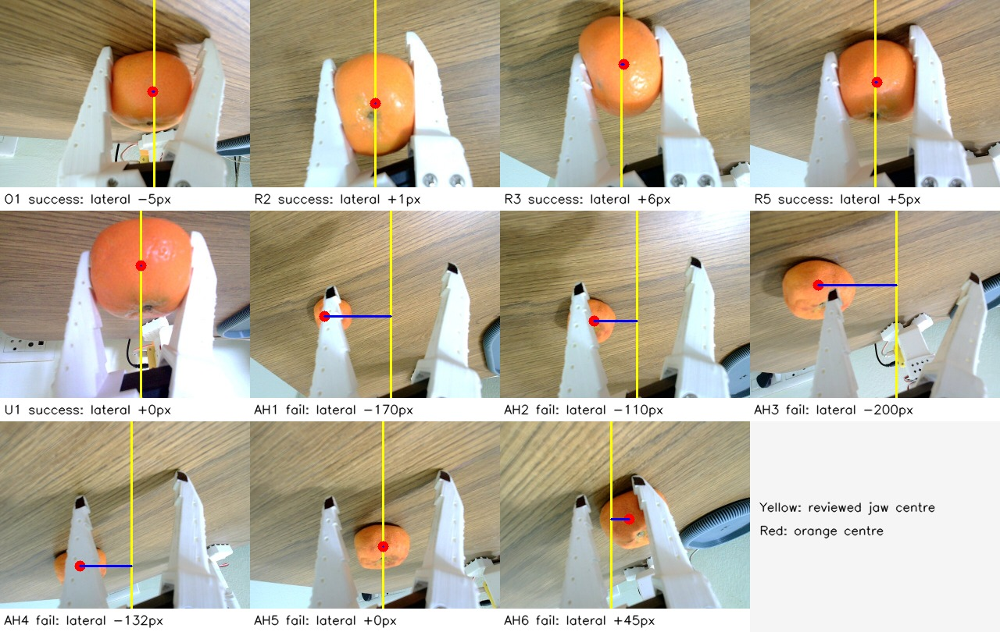

# Row AH offline grasp diagnosis

Date: 2026-11-06  
Policy: fine-tune 3, `row3_all169_conservative_010000`  
Scope: successful orange trials O1, R2, R3, R5 and U1 versus failed trials AH1-AH6  
Safety: offline image/journal analysis only; no robot connection or motion

## Result

Row AH is not explained by one fixed lateral calibration error. Four trials approached far to the left of the
orange, AH6 approached from the right, and AH5 was laterally centred but remained too shallow/far from the fruit to
make contact. The strongest measured distribution change is the starting joint state. Row AH also used object
locations that did not reproduce any one successful placement cluster.

The policy outputs were executed essentially unchanged. Across 9,000 AH action sends, only one action was clamped:
the elbow command at AH2 chunk 48 changed by 1.92 units. That event occurred away from the acquisition failure. U1
had zero clamps in 1,500 sends. The client safety clamp is therefore not causing the misses.

## Starting joint state

Values are the first measured observation in each trial, in LeRobot position units.

| group | shoulder pan | shoulder lift | elbow | wrist flex | wrist roll | gripper |
|---|---:|---:|---:|---:|---:|---:|
| successful O1/R2/R3/R5/U1 mean | -6.7 | -104.6 | 96.6 | 78.5 | -3.8 | 51.8 |
| AH1-AH6 mean | 2.2 | -100.5 | 96.7 | 76.4 | -4.1 | 42.9 |
| AH minus successful mean | **+8.9** | **+4.1** | +0.2 | **-2.1** | -0.3 | **-8.8** |

Every AH trial used almost the same shifted home state. This is outside the narrow start-state cluster of all five
selected successes. Because the policy observes joint state as well as images, this is a direct input-distribution
change, not merely a cosmetic difference in the camera view.

## Starting orange position in the front image

Centres were measured from the orange colour mask in the 640×480 policy-input image.

| trial | result | orange centre (x, y) |
|---|---|---:|
| O1 | success | (554, 275) |
| R2 | success | (400, 342) |
| R3 | success | (392, 360) |
| R5 | success | (398, 355) |
| U1 | success | (499, 314) |
| AH1 | fail | (478, 371) |
| AH2 | fail | (478, 371) |
| AH3 | fail | (461, 362) |
| AH4 | fail | (462, 363) |
| AH5 | fail | (461, 362) |
| AH6 | fail | (182, 353) |

AH1-AH5 were repeatable within two small manual-placement clusters, but neither cluster duplicated a selected
successful start. Relative to the R success cluster, AH3-AH5 were about 63-70 pixels farther right. Relative to U1,
they were about 38 pixels left and 48 pixels lower. AH6 was far outside all selected successful clusters.

## Alignment immediately before or during the first relevant close

The orange centre and jaw-corridor centre were manually reviewed in the wrist policy-input image because the orange
is partly occluded by the fingers in several frames. Pixel errors are approximate (about ±10 px) and use
`orange_x - jaw_centre_x`; negative means that the orange lies left of the corridor.

| trial/frame | result | lateral error | observation |
|---|---|---:|---|
| O1 c23 | success | -5 px | orange fills the corridor and contacts both fingers |
| R2 c15 | success | +1 px | centred, sustained hold begins |
| R3 c11 | success | +6 px | centred, sustained hold begins |
| R5 c14 | success | +5 px | centred, sustained hold begins |
| U1 c50 | success | 0 px | centred recovery grasp before transport |
| AH1 c34 | fail | -170 px | orange outside the left finger |
| AH2 c52 | fail | -110 px | orange outside the left finger |
| AH3 c15 | fail | -200 px | orange outside the left finger |
| AH4 c21 | fail | -132 px | orange outside the left finger |
| AH5 c44 | fail | 0 px | laterally centred, but fruit appears much smaller/farther away and the fingers do not contact it |
| AH6 c29 | fail | +45 px | orange overlaps the right finger; close pushes it rather than enclosing it |

The successful sample is tightly centred (absolute error 0-6 px). Four of the six AH trials have gross left errors,
one has a right error, and one passes the lateral check but fails the depth/scale check. A useful guard therefore
needs both lateral centring and apparent-size/depth conditions.

Yellow is the reviewed jaw centre, red is the orange centre, and the blue segment is the lateral error. These marks
are analysis annotations; they were not policy inputs.

## Close timing, command execution and tracking

- O1, R2, R3 and R5 secured the orange by chunks 23, 15, 11 and 14. U1 recovered from an initial miss and secured it
  around chunks 49-50.
- AH had no consistent late-close pattern: trials reached at different times, but each close was issued at an
  unsuitable spatial pose. Extending the cap would not correct this.
- AH dispatched 9,000 actions. One action (0.011%) was clamped; all others matched model output exactly.
- Comparing the final sent action of each chunk with the next measured state gives median absolute tracking errors
  `[0.28, 1.18, 0.79, 0.36, 0.21, 0.13]` for AH and `[0.24, 0.36, 0.51, 0.43, 0.16, 0.10]` for successful U1.
  The 95th-percentile errors are similar. There is no evidence of a general motor-tracking failure sufficient to
  explain the 0/6 result.
- AH6 shows a temporary gripper discrepancy after contact: the sent reopen target after chunk 31 was 27.2 while the
  next measured value remained 15.3. This is consistent with contact/lag after the failed close, not the cause of the
  initial off-centre approach.
- Median request latency was higher and more variable in AH (1.16-2.12 s) than U1 (1.24 s), but the arm holds its
  last command while awaiting the next chunk. Latency makes recovery slower; it does not explain the pre-close
  spatial error. RTC should be tested after centring is fixed.

## Camera and mechanical interpretation

The overhead camera scene is translated between historical sessions, but tray scale remains similar and successful
O, R and U trials themselves span substantial camera and object-position variation. Camera motion may contribute to
distribution shift, but the available evidence does not support it as the sole cause.

The wrist images show both fingers and a plausible opening, and action-to-state tracking is broadly comparable with
U1. A gross servo or broken-finger failure is unlikely. An empty-workspace symmetry and jaw-parallelism check is
still required before the next trial because offline images cannot measure physical finger height, backlash or
contact force.

## Ranked causes

1. **Start-state and placement distribution shift.** This is directly measured and affects both policy inputs.
2. **Unstable learned acquisition.** Nearly identical AH3-AH5 starts produced two large left misses and one centred
   but shallow approach.
3. **Missing close gate and recovery logic.** The client executes closes even when the fruit is visibly outside the
   corridor, then permits long empty searches.
4. **Possible smaller camera/physical geometry drift.** It should be checked, but it is not sufficient to explain all
   six outcomes.
5. **Action clamp, cap length and RTC.** The evidence rejects these as primary causes.

## Next controlled experiment

1. With an empty workspace, verify finger symmetry, parallelism, camera mount rigidity and gripper zero.
2. Restore one exact known successful start state rather than the AH state. U1's recorded start is
   `[-7.8, -104.0, 96.7, 78.3, -1.3, 51.3]`; it must be clearance-tested before reuse.
3. Register the current overhead image to one successful reference and reproduce that trial's orange location using
   the overlay. Do not use raw historical pixels without registration because the camera moved.
4. Add a read-only pre-close diagnostic first. A close is eligible only when the orange centre is inside the jaw
   corridor and its apparent scale shows that the fingers are at contact depth.
5. Run three hypothesis-driven trials from the same verified state and placement. If acquisition becomes repeatable,
   collect balanced demonstrations around that region. If it still fails, collect corrective demonstrations and
   fine-tune a new checkpoint before further evaluation.

This diagnostic does not justify a fixed blind wrist offset. The sign of the AH error changes, and AH5 demonstrates
that lateral centring alone is insufficient.
