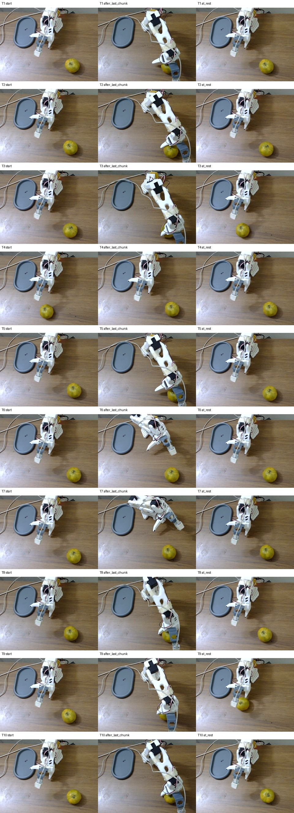

# FT4 checkpoint 3,000: restored-camera large-citrus row

Date: 2026-11-09

Result: **0/10 end-to-end (0%)**

The object was the same large green-yellow citrus used in the earlier exploratory row, not the fixed small orange.
The front camera was in the restored overhead geometry, the tray remained fixed on the left, and the task instruction
was the trained `Grab oranges and place into plate.` string. FT4 checkpoint 3,000 ran ten back-to-back trials with 20
actions per request, a 75-request cap, 30-second placement countdowns and return to start.

An initial run using an incorrect `apple` instruction was stopped at chunk 51 before meaningful motion and is excluded.
It is preserved separately at `/home/gaikwad-prakash/bench_trace_ft4_ckpt3000_apple10_20261109`.

| Trial | Result | Reviewed failure |
|---|---|---|
| 1 | fail | repeated closes at the citrus; no retained lift |
| 2 | fail | repeated closes; no retained lift |
| 3 | fail | waited until c52, then late overextended reach and close; no grasp |
| 4 | fail | remained near start; no meaningful reach |
| 5 | fail | sustained contact aperture near 40, but no lift |
| 6 | fail | rotated the folded arm; no extension or grasp |
| 7 | fail | rotated the folded arm left; no extension or grasp |
| 8 | fail | reached and made several closes; no retained lift |
| 9 | fail | late reach and close near the cap; no retained lift |
| 10 | fail | immediate reach and repeated closes; no retained lift |

All ten failures occurred at acquisition. Three trials (4, 6 and 7) never made a meaningful reach. Seven reached or
contacted the citrus but failed to secure it. No trial produced a retained lift, transport or tray release. The start,
cap and returned-to-rest frames confirm the citrus remained on the table in every trial.

The row recorded 750 observations, 750 policy responses and 15,000 dispatched actions with zero stale front or wrist
frames. Request latency was 1,182.5 ms mean, 1,184.7 ms median, 1,214.1 ms p95 and 1,543.1 ms maximum.

This is an out-of-distribution object-size result and does not change the controlled small-orange score. Combined with
the earlier large-citrus exploratory row (1/5), checkpoint 3,000 is now **1/15 (6.7%)** on this large citrus across the
two separately documented camera conditions. Do not use more blind large-citrus trials to tune the orange verifier.
Improving this object requires demonstrations that include its larger diameter and the wider contact aperture needed
to secure it.

Raw trace: `/home/gaikwad-prakash/bench_trace_ft4_ckpt3000_large_citrus10_20261109`

Chunk log: `/home/gaikwad-prakash/bench_ft4_ckpt3000_large_citrus10_20261109.jsonl`
