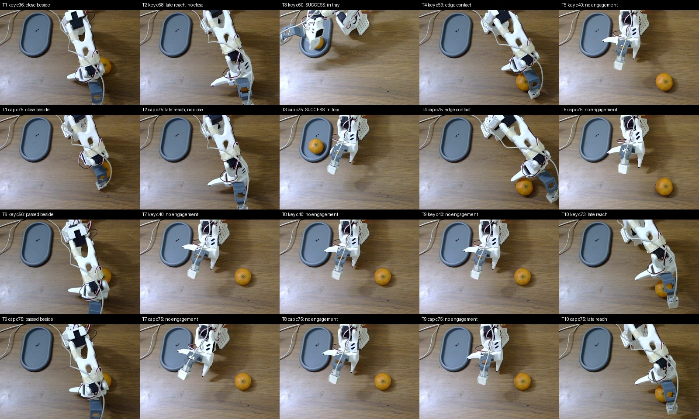

# FT4 checkpoint 3,000: regular-orange ten-trial row 2

Date: 2026-11-09

Result: **1/10 end-to-end (10%)**

See [DETAILED_ANALYSIS.md](DETAILED_ANALYSIS.md) for the synchronized camera and joint-trace review of every trial.

This row used the regular orange, not the larger green-yellow citrus from the preceding experiment. A fresh overhead
frame confirmed the empty tray on the left, the arm at its recorded start pose and the orange in the lower-right
pickup area. The task string was `Grab oranges and place into plate.`. Execution used 20 actions per request at
30 Hz, a 75-request cap, 30-second placement countdowns and scripted return to start.

| Trial | Result | Reviewed behavior |
|---|---|---|
| 1 | fail | reached and made repeated closes beside the orange; no retained lift |
| 2 | fail | waited until c56, reached late and hit the cap with the gripper open |
| 3 | **success** | centred and retained the orange around c49-50, carried it left and released it inside the tray at c59-60 |
| 4 | fail | reached, contacted the orange at the gripper edge and pushed it; no retained lift |
| 5 | fail | stayed near the start pose for the full cap |
| 6 | fail | reached late, passed beside the orange and never retained it |
| 7 | fail | stayed near the start pose for the full cap |
| 8 | fail | stayed near the start pose for the full cap |
| 9 | fail | stayed near the start pose for the full cap |
| 10 | fail | started reaching at c67 and hit the cap before a close or grasp |

The nine failures split into four no-engagement trials, three late-reach/no-close trials and two close-beside or
edge-contact trials. Only T3 produced a retained grasp; once held, the policy completed transport and release. The
dominant regression in this row was therefore task initiation, followed by acquisition accuracy.

One attempted fourth episode is excluded. The orange was still in the tray after T3, so the runner was stopped at
chunk 9 before a pickup attempt and the arm was returned to start. The remaining seven valid trials then ran from the
table in a separate trace. Startup probes and rejected launches before any policy action are also excluded.

The ten valid trials recorded 750 observations, 750 policy responses and 15,000 dispatched actions. Request latency
was 1,211.7 ms mean, 1,197.0 ms median, 1,281.8 ms p95 and 2,885.0 ms maximum. Median stage times were 773.4 ms for
observation upload and 410.0 ms for action retrieval; local JPEG encoding remained about 2-3 ms per camera.

Across the documented controlled regular-orange checkpoint-3,000 rows, the results are now 1/3 in the initial gate,
1/5 in the restored-camera probe, 3/10 in the prospective shadow row and 1/10 here: **6/28 (21.4%)**. These rows used
the same checkpoint but were conducted for different diagnostic purposes, so this aggregate is descriptive rather
than a single preregistered evaluation.

Raw traces:

- `/home/gaikwad-prakash/bench_trace_ft4_ckpt3000_regular_orange10_row2f_20261109` (valid T1-T3; excluded partial episode follows)
- `/home/gaikwad-prakash/bench_trace_ft4_ckpt3000_regular_orange10_row2_remaining7_20261109` (valid T4-T10)

Chunk logs:

- `/home/gaikwad-prakash/bench_ft4_ckpt3000_regular_orange10_row2f_20261109.jsonl`
- `/home/gaikwad-prakash/bench_ft4_ckpt3000_regular_orange10_row2_remaining7_20261109.jsonl`
