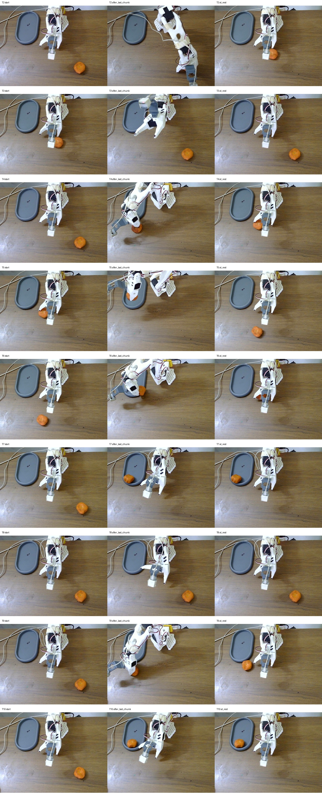

# FT4 checkpoint 3,000: prospective shadow-verifier row

Date: 2026-11-09

Physical task result: **3/10 (30%)**

Strict hands-clear subset: **2/9**; T3 completed successfully, but a hand removed the orange after completion and
before the 75-request cap

Shadow end-to-end agreement: **10/10**

Motor gate: **disabled**

This was the first independent prospective row after implementing the read-only three-stage verifier. The policy and
dispatch settings were unchanged: FT4 checkpoint 3,000, 20 executed actions per request at 30 Hz, a 75-request cap,
30-second placement countdowns and scripted return to start. Trial 1 ran alone; trials 2-10 then ran back to back.
The verifier observed the same state and images but never changed a predicted or dispatched action.

## Results

| Trial | Reviewed physical result | Shadow verdict | Close gate at successful/decisive close | Agreement |
|---|---|---|---|---|
| T1 | acquisition failure; searched open to cap | `acquisition_failure` | no close | yes |
| T2 | acquisition failure; close did not retain | `acquisition_failure` | blocked | yes |
| T3 | success; release in tray at c60 | `success` | blocked | yes |
| T4 | brief acquisition, release outside at c48 | `delivery_failure` | eligible | yes |
| T5 | retained at cap; no release | `retained_without_verified_release` | eligible | yes |
| T6 | second attempt retained, but no tray release | `retained_without_verified_release` | blocked | yes |
| T7 | success; release in tray at c65 | `success` | blocked | yes |
| T8 | acquisition failure; no close or meaningful reach | `acquisition_failure` | no close | yes |
| T9 | second attempt retained, release outside/unknown at c54 | `delivery_failure` | eligible | yes |
| T10 | success; release in tray at c64 | `success` | blocked | yes |

T3 contains a protocol exception. The orange remained visibly in the tray through c69 after the verified release at
c60. A hand entered at c70 and removed it before the cap. The robot's task completion and shadow release decision are
therefore real, but T3 is excluded from the strict hands-clear subset.

The physical failures divide into three acquisition failures (T1, T2 and T8) and four failures after some acquisition
(T4, T5, T6 and T9). T5 reached the tray while still holding the orange; the scripted return then carried it away.
T9 released on the table beside the tray. T8 exposed a separate policy failure: it stayed near the starting pose for
almost the full trial and made no grasp attempt.

## Gate decision

The retrospective outcome classifier was correct on all ten end-to-end outcomes, but the close gate is not ready.
Its two-consecutive-frame requirement would have blocked the decisive close in all three successful trials: T3, T7
and T10. This directly fails the Phase D condition that no successful acquisition may be blocked. T7 was especially
important because the wrist detector was `unknown` on the close frame even though the grasp succeeded.

The post-close retained-lift and tray checks are useful as diagnostics. They cannot rescue a gate that rejects real
successes before closing. Keep `--shadow-grasp-verifier` read-only. Before another physical row, revise the pre-close
logic and replay it on this frozen trace. A candidate must preserve T3, T7 and T10 while still flagging the failed
closes. Do not enable motor intervention from the current thresholds.

## Instrumentation

Across 750 observations, the row recorded 750 verifier decisions, 750 prediction responses and 15,000 dispatched
actions. Both camera stale counters remained zero. Request latency was 1,244.3 ms mean, 1,208.3 ms median, 1,247.5 ms
p95 and 8,643.1 ms maximum. Nine requests exceeded two seconds and six exceeded four seconds, all caused mainly by
an observation-RPC spike in T9. The usual median stages were 792.4 ms for observation upload and 406.7 ms for action
retrieval; local JPEG and serialization work remained only a few milliseconds.

Raw traces:

- `/home/gaikwad-prakash/bench_trace_ft4_ckpt3000_shadow_prospective_20261109_t1`
- `/home/gaikwad-prakash/bench_trace_ft4_ckpt3000_shadow_phase_d_t2_t10_20261109`

Chunk logs:

- `/home/gaikwad-prakash/bench_ft4_ckpt3000_shadow_prospective_20261109_t1.jsonl`
- `/home/gaikwad-prakash/bench_ft4_ckpt3000_shadow_phase_d_t2_t10_20261109.jsonl`

Key frames are in `key_frames/`; `summary.json` contains the machine-readable result.
